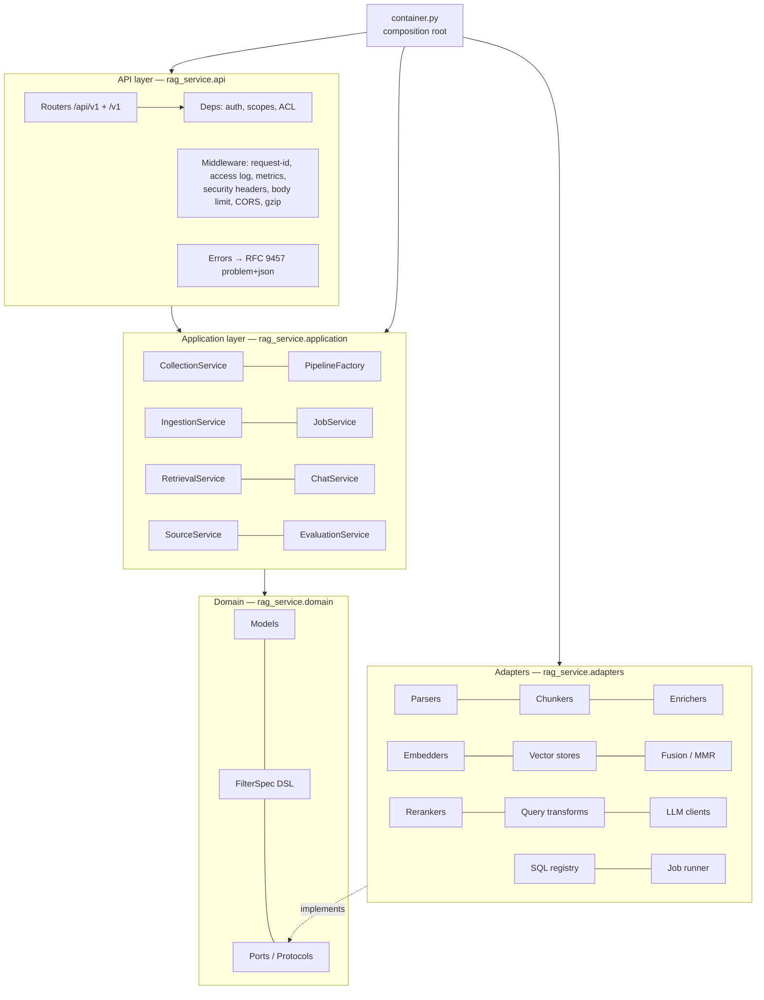
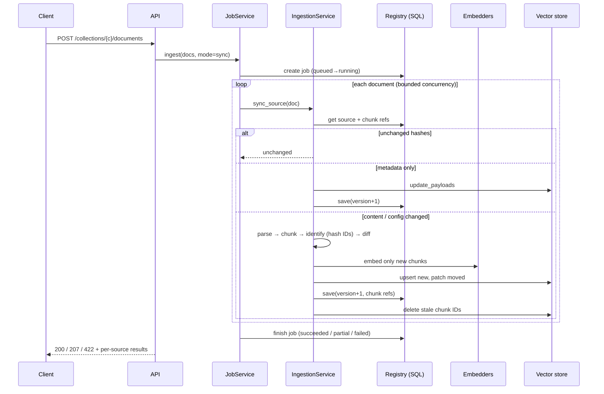
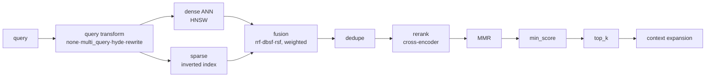
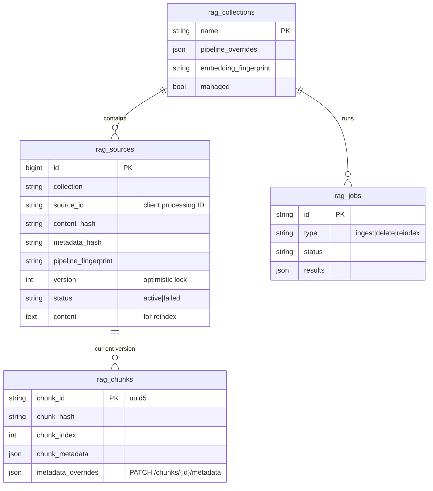

# 01 · Architecture

## Layers (hexagonal / ports & adapters)



| Layer | Package | Depends on | Never depends on |
|-------|---------|-----------|------------------|
| Core | `rag_service.core` | stdlib, pydantic | anything else in the service |
| Domain | `rag_service.domain` | core | adapters, application, api |
| Adapters | `rag_service.adapters` | core, domain | application, api |
| Application | `rag_service.application` | core, domain, adapters (only via `PipelineFactory`) | api |
| API | `rag_service.api` | everything above | — |

The "no API imports below the API layer" rule is enforced by ruff (`TID251` banned-api).

## SOLID in this code base

| Principle | Where |
|-----------|-------|
| **S**ingle responsibility | Ingestion (write side) vs `SourceService` (read side); chunkers only split; enrichers only change embedded text; `ChatService` orchestrates but delegates retrieval. |
| **O**pen/closed | `core/registry.py`: every strategy (parser, chunker, embedder, store, fusion, reranker, query transform, LLM) is looked up by name. New ones register themselves — no edits to existing code. Entry-point plugins (`rag_service.plugins`) and the `plugins:` config key load external components. |
| **L**iskov substitution | One behavioural contract suite (`tests/integration/test_store_contract.py`) runs unchanged against memory, embedded Qdrant, Qdrant server and pgvector. |
| **I**nterface segregation | `VectorStore` = `CollectionAdmin` + `VectorWriter` + `VectorReader`. Ingestion depends on the writer, retrieval on the reader, collections on the admin port. |
| **D**ependency inversion | Services receive ports in their constructors; only `container.py` knows concrete classes. Tests swap in a counting embedder, a fake LLM, an in-memory store. |

Other patterns: **Factory** + component cache (`PipelineFactory`), **Decorator** (`CachedDenseEmbedder`), **Template method** (`BaseChunker.split`), **Strategy** (fusion, rerank, query transform), **Unit of work** (registry `save` replaces a source and its chunk refs atomically), **Optimistic concurrency** (source `version`).

## Request flows

### Ingestion (sync mode)



### Retrieval



### Chat

`prepare` (validate → condense follow-up → retrieve → pack `<source id="n">` blocks within the
token budget) runs **before** a stream is opened so request errors keep proper HTTP statuses;
`stream` then emits `retrieval → delta* → done` events. No sources ⇒ `no_context_answer`
without an LLM call.

## Data model



Vector point payload (every store):

```json
{
  "text": "chunk text returned to clients",
  "source_id": "kb:fans:fv-20vq3",
  "chunk_index": 3,
  "chunk_hash": "…",
  "title": "Panasonic FV-20VQ3",
  "mime_type": "text/markdown",
  "metadata": {"brand": "Panasonic", "page": 2, "section": "Specs > Noise", "…": "…"}
}
```

## Package map

```
src/rag_service/
├── core/          config.py (settings schema + loader) · errors.py · logging.py · registry.py · utils.py
├── domain/        models.py · filters.py (DSL + reference semantics) · ports.py (Protocols)
├── adapters/
│   ├── parsers/       text, markdown, html, json, csv, pdf
│   ├── chunking/      length functions; fixed/recursive/sentence/markdown/semantic
│   ├── enrichment/    contextual headers, LLM contextual retrieval
│   ├── embedding/     hash, lexical (offline) · fastembed dense/sparse · OpenAI-compatible · LRU cache
│   ├── vectorstores/  memory · qdrant · pgvector
│   ├── fusion/        rrf · dbsf · rsf · mmr
│   ├── rerank/        fastembed cross-encoder · Cohere-compatible HTTP
│   ├── query/         multi_query · hyde · rewrite
│   ├── llm/           anthropic · openai-compatible · gemini · claude-lite-llm (subscription CLI) · extractive
│   ├── persistence/   SQL registry (SQLAlchemy async)
│   └── jobs/          in-process runner, keyed locks
├── application/   pipeline · collections · ingestion · retrieval · chat · jobs · sources · evaluation
├── api/           app factory · middleware · security · errors · deps · SSE · routers · OpenAI facade
└── container.py   composition root
```
