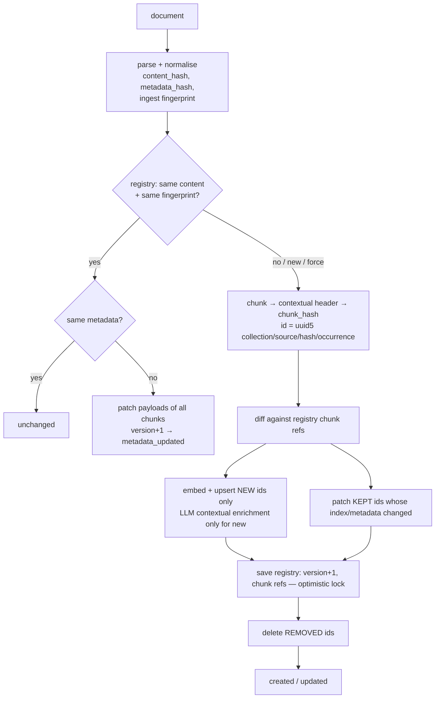

# 03 · Ingestion & source synchronisation

## The processing ID (`source_id`)

Every document is identified by a client-supplied **`source_id`** — the stable *processing ID* of
that document in your system (a CMS page ID, a SKU, a file key). It is the handle for every later
operation:

| You want to… | Call | Result |
|---|---|---|
| Ingest new content | `POST /collections/{c}/documents` or `PUT /collections/{c}/documents/{source_id}` | `created` |
| Re-send unchanged content | same | `unchanged` — nothing is touched |
| Change only metadata / title | same, or `PATCH …/documents/{source_id}/metadata` | `metadata_updated` — payloads patched, **no re-embedding** |
| Change the content | same | `updated` — only chunks whose text changed are embedded; stale chunks are deleted |
| Remove the document | `DELETE …/documents/{source_id}` or `POST …/documents:delete` | `deleted` — every chunk and the registry row are removed |
| Force a full re-embed | `options.force: true` | every chunk re-embedded in place |

`source_id` rules: 1–512 characters, `A-Z a-z 0-9 _ - . : @ = + ~`, starting with a letter or digit.
`/` is not allowed so IDs are path-safe; use `:` or `.` for hierarchy (`kb:fans:fv-20vq3`). Omit
it on `POST` and the service generates one (`src_…`) and returns it.

## Request formats

```jsonc
POST /api/v1/collections/products/documents
{
  "documents": [
    {                                   // 1) raw text (plain, markdown, html, csv, json)
      "source_id": "kb:fans:fv-20vq3",
      "title": "Panasonic FV-20VQ3",
      "mime_type": "text/markdown",
      "content": "# Panasonic FV-20VQ3\n\n…",
      "metadata": {"brand": "Panasonic", "cfm": 190, "tags": ["quiet"]},
      "chunking": {"strategy": "markdown", "chunk_size": 256}     // optional per-document override
    },
    {                                   // 2) binary file as base64 (e.g. PDF → one section per page)
      "source_id": "manual:fv-20vq3",
      "mime_type": "application/pdf",
      "content_base64": "JVBERi0xLjcK…",
      "metadata": {"doc_type": "manual"}
    },
    {                                   // 3) bring-your-own chunks, each with its own metadata
      "source_id": "faq:fans",
      "chunks": [
        {"text": "How loud is it? 0.3 sones.", "metadata": {"qa_id": 17}},
        {"text": "Does it have a light? Yes.",  "metadata": {"qa_id": 18}}
      ],
      "metadata": {"brand": "Broan"}
    }
  ],
  "options": {"mode": "sync", "force": false, "callback_url": null}
}
```

Exactly one of `content`, `content_base64` or `chunks` per document. Metadata keys may not contain
`.` or start with `$` (they are addressable in filters as `metadata.<key>`).

### Sync vs async

| mode | HTTP | Body |
|------|------|------|
| `sync` (≤ `ingestion.sync_max_documents`) | `200` all ok · `207` some failed · `422` all failed | job with per-source `results` |
| `async` | `202` + `Location: /api/v1/jobs/{id}` | job (poll it; optional `callback_url` is POSTed on completion) |

Per-source result:

```json
{"source_id": "kb:fans:fv-20vq3", "action": "updated", "version": 3,
 "chunks_total": 12, "chunks_added": 1, "chunks_removed": 2, "chunks_unchanged": 9, "chunks_updated": 0,
 "error": null, "error_code": null, "duration_ms": 41.7}
```

A failed source never fails the batch; it is recorded with `status: failed` and its error, and the
next successful sync clears it.

## The sync algorithm



* **content_hash** — SHA-256 of the normalised sections (or client chunks) including section
  metadata such as page numbers.
* **ingest fingerprint** — hash of the embedding fingerprint + effective chunking config (including
  the per-document override) + enrichment config. Changing chunk size, strategy, embedding model or
  header template makes the next sync re-chunk.
* **chunk_hash** — hash of fingerprint + embedded text + chunk text. Because the chunk ID derives
  from it, an unchanged paragraph keeps its ID (and its vectors) even when paragraphs around it
  move; only the moved chunks' `chunk_index` is patched.
* **Write order** — upsert new → save registry → delete stale. A crash leaves at worst a duplicate
  that the next sync removes; never a gap. Upserts are idempotent (deterministic IDs).
* **Concurrency** — syncs of the same source are serialised by a per-source lock inside a process;
  across replicas the registry's `version` column provides optimistic locking
  (`CONCURRENT_MODIFICATION` → retry).
* **Orphan safety net** — when the registry knows no chunks for a source, points with that
  `source_id` are deleted by filter before writing (covers a wiped registry or a failed first run).

## Metadata

| Level | How to set | Survives re-sync? |
|---|---|---|
| Document | `metadata` in the ingest request, or `PATCH …/documents/{id}/metadata` (`merge: true` deep-merges) | Replaced by what you send next time |
| System per-chunk | Added automatically: `page`, `section`, `headers`, `row`, `item`, `start_char`, `end_char`, `llm_context` | Recomputed |
| Client per-chunk (pre-chunked input) | `chunks[].metadata` | Replaced by what you send next time |
| Chunk override | `PATCH /collections/{c}/chunks/{chunk_id}/metadata` | **Yes**, while the chunk's content is unchanged |

Effective chunk metadata = `document ∪ system/client chunk ∪ override` (right wins). All of it is
filterable at retrieval time.

## Re-indexing after configuration changes

The registry keeps each source's normalised content (`registry.store_content: true`), so a
collection can be rebuilt without clients re-sending anything:

| Change | Action |
|---|---|
| Chunking / enrichment | `POST /collections/{c}/reindex` — sources are re-chunked; only chunks whose text changed are re-embedded |
| Embedding model, dimension, distance, prefixes | The collection becomes **stale** (ingest/retrieve return `409 EMBEDDING_CONFIG_CHANGED`). Run `POST /collections/{c}/reindex?recreate=true` to drop and rebuild the index |
| Retrieval / generation settings | Nothing — they apply on the next request |

For zero-downtime model migrations, create a new collection with the new model, reindex into it,
switch clients, then delete the old one (see [06-vector-stores.md](06-vector-stores.md)).

## Parsing

| MIME type | Parser | Sections |
|---|---|---|
| `text/plain` | UTF-8 (BOM aware) | whole document |
| `text/markdown` | title = first `#` heading | whole document (use `strategy: markdown` for header-aware chunks) |
| `text/html` | scripts/nav/footer dropped; headings and lists → Markdown | whole document |
| `application/json` | `key: value` lines; top-level arrays → one section per item | per item |
| `text/csv` | `column: value` lines | **one per row** — rows are retrieved independently |
| `application/pdf` | pypdf text extraction (extra `pdf`) | **one per page** → `metadata.page` |

Text is NFKC-normalised, control characters are removed and whitespace is collapsed (paragraph
breaks kept). Scanned PDFs need OCR before ingestion.
